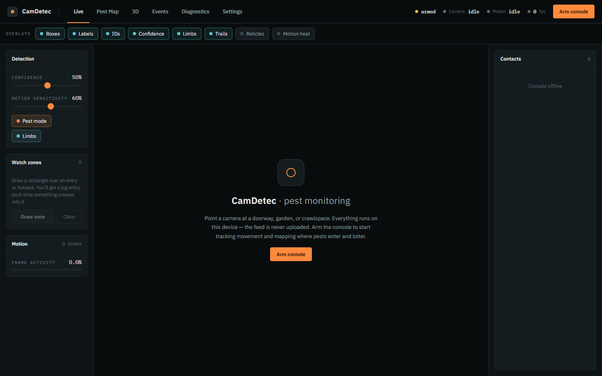

# CamDetec: In-Browser Pest Detection Console

**Live demo: [cam-detec.vercel.app](https://cam-detec.vercel.app)** (needs a webcam; click *Arm console*)

Point a camera at a doorway, garage, or crawlspace and CamDetec watches for
rodents, logs every sighting with a snapshot, and maps where pests enter and
linger. All inference runs **locally in the browser** with TensorFlow.js, so
the video feed never leaves the device and there's no server cost.



**Highlights**

- **Custom rodent detector.** I trained a YOLOv8n model on 6 merged rodent
  datasets (mAP50 **0.919**, mAP50-95 0.710) and converted it to run in the
  browser (~19 ms per frame warm in testing).
- **Real-time pipeline.** Object detection, frame-differencing motion
  detection, an IoU tracker with smoothing for stable IDs, and MoveNet pose,
  all driven from a single `requestAnimationFrame` loop outside React.
- **Built for unattended use.** Discord/Telegram/browser alerts, evidence
  snapshots in IndexedDB, low-light boost, a dwell heatmap with trap-placement
  suggestions, and an installable PWA with screen wake lock.
- **Retraining loop.** Flag false positives in the UI and export them as a ZIP
  ready to upload back to Roboflow for the next training run.

**Stack:** Next.js 16, React 19, TypeScript, TensorFlow.js, three.js /
react-three-fiber, zustand, IndexedDB · Training: Python, Ultralytics YOLOv8,
Google Colab, ONNX

---

## What it does

- **Live detection.** Pick COCO-SSD (MobileNet v2, ~80 general classes) or the
  custom **YOLOv8 rodent model** in Settings. Detections go through IoU
  **object tracking + temporal smoothing** for stable boxes, stable IDs, and
  enter/exit events.
- **Motion detection.** Model-free frame differencing flags *where* something
  is moving, even for objects no model recognizes.
- **Tabbed HUD.** Live, Pest Map, 3D, Events, Diagnostics, Settings. Overlays
  are toggle chips, not a fixed wall of stats.
- **Pest Map.** A dwell heatmap of where pests spend time, with suggested trap
  locations.
- **3D view.** Places contacts and motion zones on a floor grid relative to the
  camera's field of view.
- **Events + evidence.** Every pest event is saved to IndexedDB with an
  annotated snapshot and can be exported as CSV/JSON.
- **Alerts.** Browser notifications and Discord/Telegram webhooks with
  per-channel cooldowns, sent straight from the browser (no backend).

## The rodent model

COCO-SSD doesn't know rodents, so `training/train_pest_model.ipynb` trains one:

1. Merges 3 private + 3 public Roboflow rodent datasets into a single `rodent`
   class.
2. Trains YOLOv8n at 640px on a free Colab T4, checkpointing to Google Drive so
   a dropped session resumes instead of restarting.
3. Exports to TensorFlow.js. Ultralytics' tfjs export doesn't work on Windows,
   so the conversion goes ONNX → onnx2tf → tfjs, parity-checked against ONNX
   (max abs diff 4.3e-4).

The detector sits behind a `Detector` interface (`lib/detector.ts`), so the
model swapped in without touching the tracker, motion engine, or UI. See
[training/README.md](training/README.md) for details.

## Architecture

```
lib/
  detector.ts          pluggable Detector interface (COCO-SSD + YOLO tfjs)
  motion.ts            frame-differencing motion detector (grid + regions)
  tracker.ts           greedy IoU tracker with EMA smoothing
  pose.ts              MoveNet limb tracking
  dwell.ts             dwell heatmap + trap suggestions
  pest.ts              pest-class predicate + defaults
  engine.ts            hot-path state shared with render loops (outside React)
  store.ts             zustand store (UI state + throttled snapshots)
  history-db.ts        IndexedDB event + snapshot history
  alerts.ts            browser / Discord / Telegram alerts
  snapshot.ts          annotated evidence snapshots
  lowlight.ts          gamma/contrast boost for dark scenes
  zip.ts               dependency-free ZIP writer for flagged-event export
  useCamera.ts         getUserMedia lifecycle
  useDetectionLoop.ts  the rAF loop that drives everything
components/
  hud/                 TopBar, DetectionOverlay (live canvas), ToggleChip
  tabs/                Live, Pest Map, 3D, Events, Diagnostics, Settings
  three/               SpatialView (react-three-fiber)
```

Per-frame data lives in `engine` (a plain module singleton) so the render loops
read it every frame without triggering React re-renders. Only low-frequency
snapshots (contacts, stats, diagnostics) flow through the store.

## Develop

```bash
npm install
npm run dev      # http://localhost:3000 (allow camera access)
npm run build
```
